# FlashAttention Accelerator — RTL / ASIC Portfolio

**Stateful INT8 attention in SystemVerilog — persistent KV cache, shared 16 × 16 compute and an AXI host SoC.**

## Project Overview & Recorded Highlights

**V2 is the flagship implementation:** four query heads execute serially over two
physical KV groups using one 16 × 16 systolic array. The host-controlled SoC
supports bounded prefill, append and decode jobs, masked online softmax, and
external result writeback. V1 is the separately verified single-head foundation.

- **58.39% lower standard-cell area** in the frozen matched d16 synthesis comparison, using 16 versus 256 dequantizers. The matched four-head warm d16 RTL job takes **1,228 → 1,292 cycles (+5.21%)**. [Area evidence](docs/RESULTS.md#matched-d16-full-soc-synthesis--measured-pre-layout) · [Host latency](docs/RESULTS.md#full-soc-sharing-latency--measured--verified)
- **3.12× / 3.60× single-head decode speedup** for d16/d64 from query-row-aware output traversal, in a separate warm-L16 experiment excluding host/writeback latency. [Traversal experiment](docs/RESULTS.md#single-head-traversal-experiment--measured--verified)
- **50% fewer K/V read-payload bytes** in the separate matched serial GQA experiment; total read payload falls **33.33%**. [Matched traffic](docs/RESULTS.md#physical-gqa-reuse--measured)
- **120 bounded SoC executions / 4,224 successful commands / 3,225,600 exact output words**, across d16/d64 and both dequantizer configurations. [Recorded qualification](docs/v2/evidence/verification/verification.json)

Results cover bounded fixed-point RTL and pre-layout standard cells. SRAM/ROM are
logical blackboxes; matched d64 mapped PPA and complete physical/formal closure
remain unavailable. The design has not been deployed in silicon or an FPGA.

[Overview](#project-overview--recorded-highlights) · [V2 SoC](#v2-soc-architecture) ·
[Prefill & decode](#stateful-prefill--decode) · [Memory banking](#memory-banking--persistent-kv-cache) ·
[Shared compute](#shared-compute-datapath--online-softmax) · [Results & PPA](#key-optimizations--ppa) ·
[Verification](#verification--reproduction) · [V1 & docs](#v1-evolution--documentation)

## V2 SoC Architecture

The [production SoC](rtl/v2/soc/flash_attn_soc.sv), selected by [`soc.f`](rtl/v2/soc/soc.f),
connects host control, DMA, persistent storage and one shared compute engine.
Serial head scheduling reuses the datapath while Q0/Q1 select KV0 and Q2/Q3 select KV1.

[](docs/v2/figures/soc_architecture.svg)

*Four query heads share one engine; the job adapter owns normalized results through packing and AXI writeback.*

- **Control and ownership:** 32-bit AXI4-Lite CSRs hold configuration and expose control/status and IRQ. The Job Adapter captures accepted active descriptors and owns compute/result lifetime through writeback. Busy attempts cannot replace the active job.
- **Memory and compute:** 64-bit AXI reads fill one reusable Q scratchpad and the selected persistent K/V stores. Foreground tile loads supply the shared array; physical GQA sharing avoids duplicate KV storage and input loads while retaining all four query-head computations.
- **Result lifetime:** normalized INT32 words are copied into per-head result registers, packed into 64-bit words and written to external memory. Compute completion alone does not release the host job; successful output completion also requires source retirement, the final accepted OKAY AXI B response and no outstanding writes.

The C++ host and external-memory responder are **simulation-only**, outside the
synthesizable DUT. The design includes 81 logical SRAM and 16 ROM instances;
published PPA excludes their physical implementations.

[Architecture and arithmetic](docs/ARCHITECTURE.md) · [Host job adapter](rtl/v2/soc/soc_job_adapter.sv) ·
[Serial scheduler](rtl/v2/soc/flash_attn_serial.sv)

## Stateful Prefill & Decode

**PREFILL builds the cache; DECODE reuses it.** PREFILL establishes 16 K/V tokens
and computes 16 query rows per head. A separate APPEND adds one token per physical
KV group; DECODE loads one query per head and attends to the resident sequence.
These are separate host commands with one active owner at a time.

[](docs/v2/figures/stateful_sequence.svg)

*KV state persists across healthy jobs and ACK. APPEND has no output writeback; the figure's final-B completion condition applies to PREFILL/DECODE.*

| Supported host contract | Scope |
|---|---|
| Heads / dimension | Fixed 4Q:2KV; HEAD_DIM 16 or 64 |
| PREFILL | 16 query rows per head; establishes 16 cached KV tokens |
| DECODE | One query per head at absolute position L−1; L16/17/18 |
| Cache / lifecycle | Capacity 64; separate APPEND, CLEAR and result ACK |

For PREFILL/DECODE, successful DONE and enabled success IRQ wait for source
retirement, the final accepted OKAY B response and no outstanding writes.
APPEND completes after paired K/V stores and child completion, without compute
or output writeback. **ACK releases job/result ownership; IRQ clear is separate.**
CLEAR invalidates cache metadata without zeroing SRAM.

<details>
<summary>Command dataflow, cache publication and fault recovery</summary>

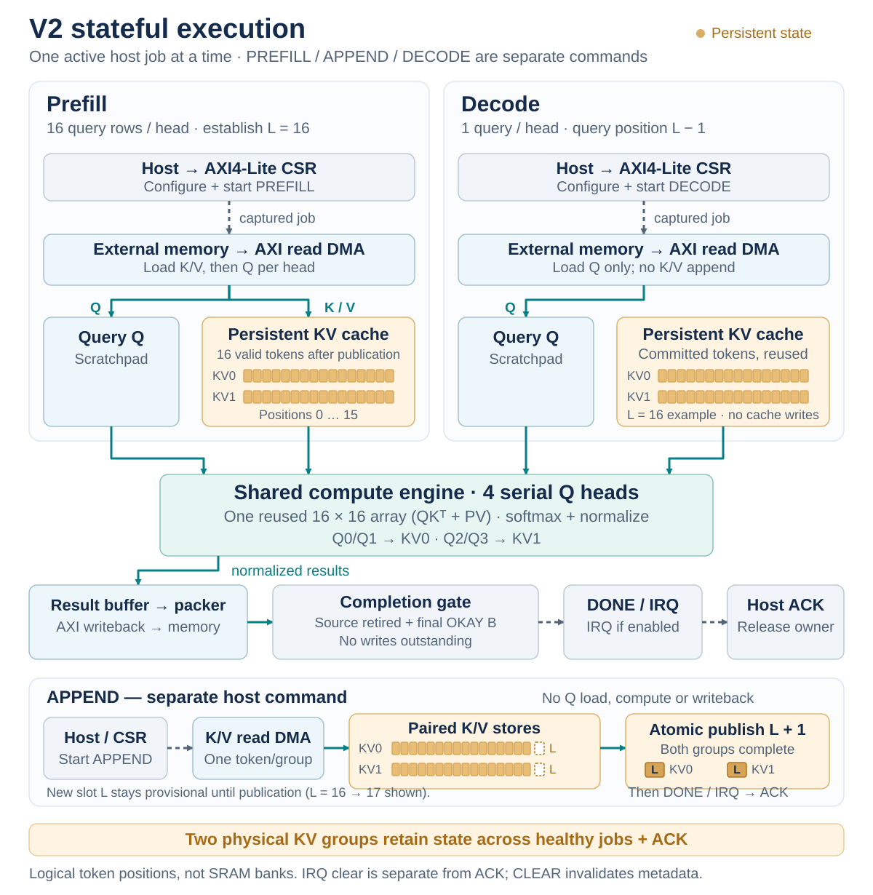

*PREFILL populates KV and computes full query tiles; DECODE loads Q and reads committed KV; APPEND publishes a complete new K/V pair in both groups.*

The token sketches show logical positions rather than SRAM banks. PREFILL compute
may consume complete K/V pairs before final metadata publication. APPEND performs
no Q load, compute or output writeback; both physical groups must complete paired
K/V stores before the new valid length is published.

Rejected or faulted operations cannot publish provisional cache contents. Fatal
AXI faults require common DUT/endpoint reset; completed external writes are not
rolled back.

[Operating and safety contract](docs/v2/VERIFICATION.md) ·
[Reproducible stateful-dataflow source](tools/v2/generate_stateful_dataflow.py)

</details>

## Memory Banking & Persistent KV Cache

**Banking connects the 64-bit DMA interface to 16-byte tile stripes.** The read DMA
assembles two accepted 64-bit beats into one aligned 128-bit write. Q uses one
reusable scratchpad, replaced before each serial query head; KV0 and KV1 each
retain separate K and V stores across healthy commands and ACK, subject to the
cache lifecycle above.

[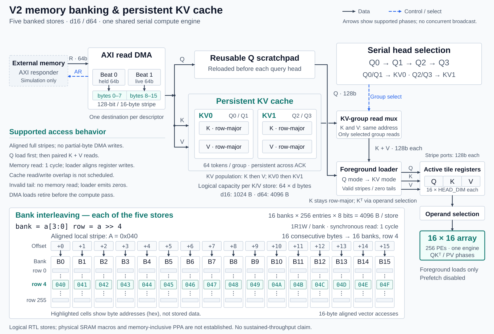](docs/v2/figures/memory_banking.svg)

*An aligned 16-byte stripe spans 16 byte-wide banks. During compute setup, the foreground loader reads Q first, then paired K/V from only the selected group into active tile registers.*

Initial PREFILL DMA population writes K then V for KV0, then KV1, before Q is
loaded for each serial query head.

Each of the five stores has **16 banks × 256 entries × 8 bits = 4096 allocated
bytes**. Byte address `a` selects bank `a[3:0]` and row `a>>4`. Logical KV capacity
is **64 tokens per group**: each K or V store uses 1024 bytes at d16 and 4096 at d64.
The allocated geometry therefore differs from the logical d16 cache footprint.

Each bank supplies one synchronous read and one write port; reads have one-cycle
memory latency. The loader aligns returned stripes into active Q/K/V tile
registers and emits zeros for invalid tails without issuing those memory reads.
K remains row-major; compute operand selection supplies Kᵀ. Cache read/write
overlap is not scheduled, and **V2 prefetch is disabled**. Stripe width describes
the implemented access path, not a sustained-throughput guarantee or physical SRAM macro.

[Banked scratchpad](rtl/memory/banked_scratchpad.sv) · [Persistent cache](rtl/v2/cache/kv_cache_banked_decode.sv) ·
[Foreground loader](rtl/v2/compute/banked_tile_loader_decode.sv) · [Read DMA](rtl/interface/dma_engine_vec.sv)

## Shared Compute Datapath & Online Softmax

**QKᵀ and PV reuse the same 16 × 16 array (256 PEs).** QK uses signed INT8 Q/K
operands with INT32 accumulation; PV switches the operand mux to unsigned 8-bit
exponential weights and signed INT8 V. This scheduling shares the multiplier array
between the two matrix products instead of duplicating compute hardware.

[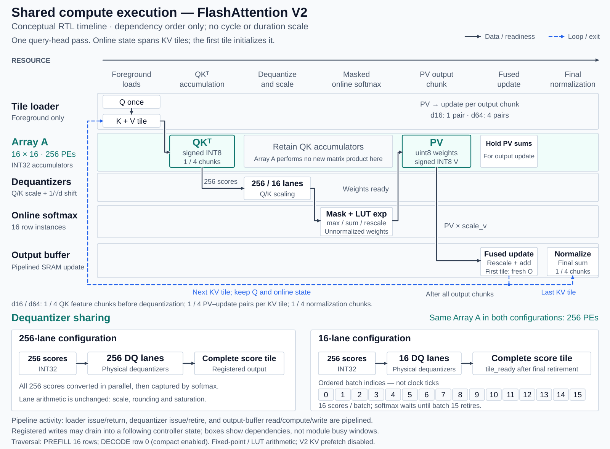](docs/v2/figures/shared_compute_timeline.svg)

*One physical array executes both matrix products. d64 uses four QK accumulation chunks, then four PV/update pairs per KV tile; phase widths carry no timing meaning.*

- **Chunk scheduling:** d16 uses one 16-feature chunk. d64 accumulates four QK chunks before dequantization, then performs four output-feature chunks, each as PV followed by a fused output update. Final normalization traverses the output chunks after the last KV tile.
- **Complete score tiles:** `DEQUANT_LANES=256` is the parallel default. With 16 physical dequantizers, each 256-score tile passes through 16 ordered batches; softmax waits until the last batch retires. Both configurations keep the same 256 PEs and lane arithmetic. Physical lane count is independently checked in the elaborated hierarchy.
- **Cross-tile state:** 16 online-softmax instances maintain per-query-row maxima, sums and rescale factors across KV tiles. Only eligible keys contribute; a score tile is staged rather than writing the full attention matrix to external memory. State starts fresh at the first tile of each query pass. The output buffer fuses prior-output rescaling with the new PV contribution, then normalizes using the final running sum.

KV cache state persists across host commands; per-query softmax/output state does
not. First-tile output updates ignore prior buffer contents. Registered loader,
dequantizer and output-write activity is pipelined, so the conceptual stages are
not non-overlapping module busy windows. LUT approximation, saturation, clamping,
rounding and fixed-point wrap remain part of the numerical contract; bit-exact
reference agreement does not establish floating-point equivalence.

<details>
<summary>Online recurrence, masking and fixed-point arithmetic</summary>

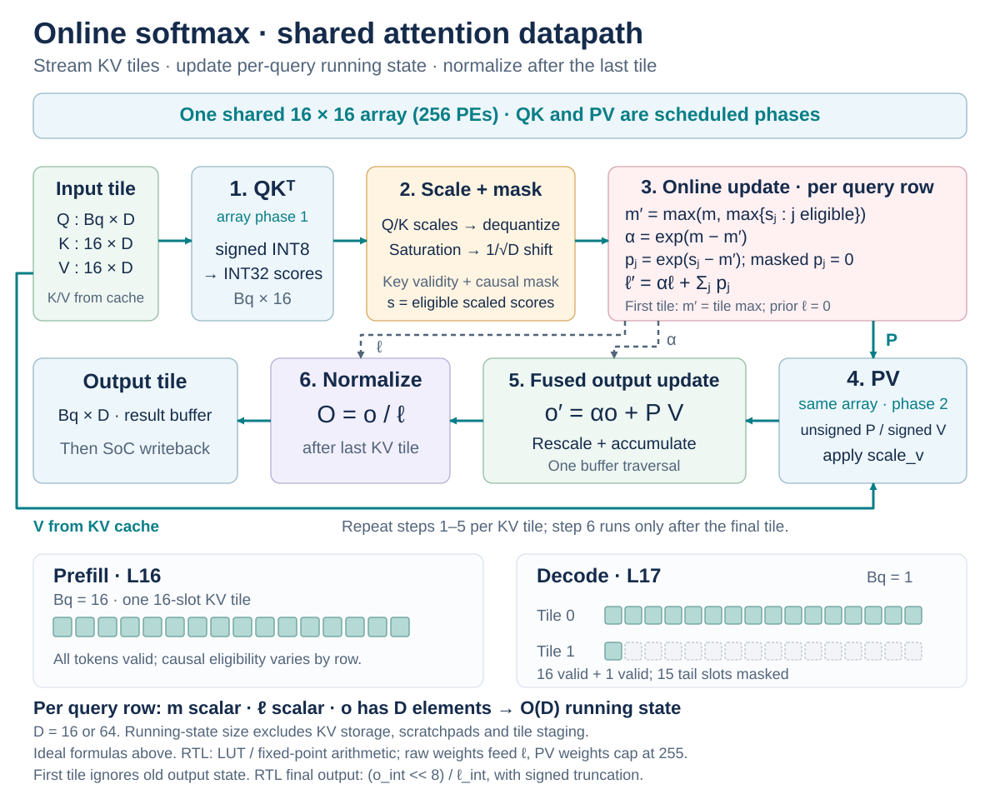

*Running state spans KV tiles; normalization follows the last tile. The recurrence is ideal mathematics, with explicit fixed-point RTL qualifications.*

1. **QKᵀ:** signed INT8 Q and K produce INT32 dot-product accumulations. d64 uses four 16-feature chunks.
2. **Scale and mask:** dequantization applies signed Q8.8 scales, rounding, INT16 saturation and the supported 1/√d shift. Invalid and causal-masked keys are excluded from softmax maxima and sums.
3. **Online softmax:** each row updates its running maximum and sum, generates LUT-based exponential weights and rescales previous output state.
4. **PV:** unsigned 8-bit exponential weights and signed INT8 V reuse the array; the PV contribution applies Q8.8 `scale_v`. d64 processes four output-feature chunks.
5. **Fused output update:** one output-buffer traversal rescales the prior accumulator and adds the current PV contribution. First-tile updates ignore prior output contents.
6. **Final normalization:** after the last KV tile, the running output accumulator is divided by the running sum to produce signed 32-bit fixed-point results.

For supported L17 decode, the second 16-slot KV tile has one valid key; masks
exclude its 15 tail slots from attention. Raw Q8.8 LUT weights feed the denominator,
while PV weights are capped at 255. RTL normalization performs signed truncating
division `(o_int << 8) / sum_int`. Diagram arrows summarize tile values and state
factors rather than simultaneous hardware activity.

[Parallel/shared dequantizer detail](docs/v2/figures/dequantizer_sharing.svg) ·
[Reproducible online-softmax source](tools/v2/generate_online_softmax.py) ·
[Arithmetic and numerical limits](docs/NUMERICAL_ACCURACY.md)

</details>

[Compute core](rtl/v2/compute/flash_attn_core_decode.sv) · [Tile/phase controller](rtl/v2/compute/tile_controller_decode.sv) ·
[Masked online softmax](rtl/v2/compute/online_softmax_masked.sv) · [Fused output buffer](rtl/memory/output_buffer.sv)

## Key Optimizations & PPA

Each comparison below retains its own workload, interface boundary and source
identity. RTL latency, frozen synthesis and activity-based energy are distinct
measurements; the single-head and serial-GQA experiments have separate baselines.

### Dequantizer sharing — matched d16 area and warm-job tradeoff

Sharing score dequantizers reduces mapped cell area while adding RTL job cycles
and reducing mapped timing margin. The matched **frozen d16 PPA baseline**,
checkpoint **`5b486419`**, reports **58.394905% lower standard-cell area** with
16 versus 256 lanes under the same 10 ns constraint.

[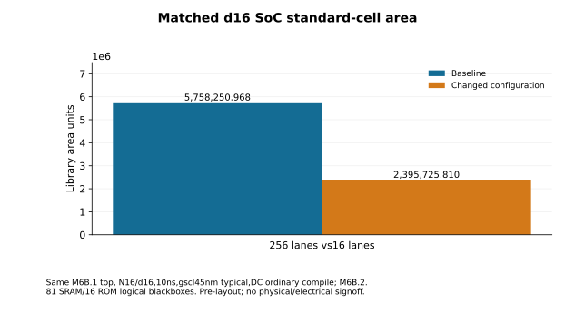](docs/v2/figures/soc_area.svg)

*Matched d16 DC pre-layout area; 81 SRAM and 16 ROM instances are logical blackboxes. This result does not establish mapped PPA for the current d16/d64 integration.*

The separate matched warm **four-head d16/L16 RTL host job** takes **1,228 → 1,292
cycles (+5.21%)** at modeled AXI latency 0, including packing/writeback and excluding
cache population, CSR setup and ACK. Estimated total standard-cell job energy is
**2.246 → 2.059 µJ (8.34% lower)**; **dynamic energy is only 0.30% lower**, so most
total-energy savings reflect leakage. The estimate covers one matched warm workload.

SRAM/ROM physical implementations and routed parasitics are excluded. Nonzero-limit
capacitance violations remain; electrical/physical signoff and mapped equivalence
are open. d64 function and DC analysis/elaboration/link passed, but **matched d64
mapped PPA is unavailable**.

<details>
<summary>Exact d16 area, timing and activity-based power measurements</summary>

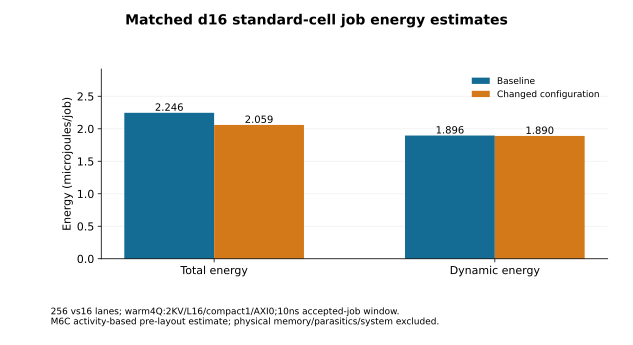

*Total estimated job energy falls 8.34%; dynamic energy falls only 0.30%. The estimate excludes physical memory, routed parasitics, clock-tree and system energy.*

| Measurement | 256 lanes | 16 lanes | Interpretation |
|---|---:|---:|---|
| Standard-cell area, library units | 5,758,250.967611 | 2,395,725.809614 | **58.394905% lower**, pre-layout DC |
| Setup slack at 10 ns, ns | +3.918528557 | +0.459291458 | Zero setup TNS/violating paths in both |
| Nonzero-limit max-cap violations | 2 | 1 | Electrical signoff remains open |
| Warm L16 host latency, cycles | 1,228 | 1,292 | Modeled AXI0; includes packing/writeback |
| Estimated total standard-cell power, mW | 182.763174 | 159.234151 | One matched warm workload |
| Estimated total job energy, µJ | 2.24615940846 | 2.05889757243 | **8.336979% lower** |
| Estimated dynamic job energy, µJ | 1.89573309201 | 1.88997247972 | Only **0.303873% lower** |

Area/timing use the earlier **frozen d16 PPA baseline**, checkpoint `5b486419`, with DC R-2020.09-SP4, typical gscl45nm, 10 ns clock, 1 ns I/O delays and ordinary `compile`. Both saved-DDC checks find zero mapped latches and unresolved references. These endpoints do not establish mapped equivalence or mapped PPA for the current d16/d64 integration.

Power uses PrimeTime/PrimePower with the original matched d16 synthesis artifacts and measured VCS activity. The warm noncausal 4Q:2KV/L16 job excludes cache population, CSR setup and ACK. Its window includes the full DONE cycle: `(host latency + 1) × 10 ns`. Lower estimated total energy largely reflects leakage savings; dynamic energy is nearly unchanged. Physical memory, routed parasitics, clock-tree and system energy are excluded, and default/propagated activity remains disclosed. [PPA evidence](docs/v2/evidence/results/ppa.json) · [Power evidence](docs/v2/evidence/results/power.json)

</details>

### Query-row-aware decode — single-head traversal experiment

Decode owns one query row, so output update and normalization visit only that row
instead of traversing 15 padded rows. Prefill retains full traversal; arithmetic,
array invocation counts and read traffic remain unchanged, and delayed writes
still drain before completion.

[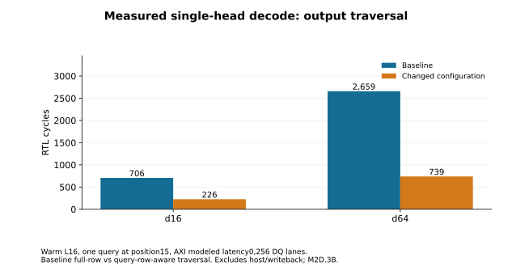](docs/v2/figures/decode_cycles.svg)

*Single-head warm L16, position 15, 256 dequantizer lanes, modeled AXI latency 0: 3.12× / 3.60× speedup for d16/d64. Cycles exclude host setup and AXI output writeback.*

<details>
<summary>Traversal mechanism and measurement conditions</summary>


Update and normalization each change from 257 to 17 cycles per output-feature
chunk. d16 saves 480 cycles; d64 saves 1,920 across four chunks. Each PV chunk has
its own update; normalization of all output chunks occurs after the last KV tile.
These single-head measurements are separate from four-head host latency.

[Traversal experiment and modeled-latency sweep](docs/RESULTS.md#single-head-traversal-experiment--measured--verified) ·
[Original measurement derivative](docs/v2/evidence/results/decode_before_after.csv)

</details>

### Physical GQA sharing — matched read-payload experiment

The earlier matched five-command serial GQA experiment measures **2,304 → 1,152
K/V read bytes (−50%)** and **3,456 → 2,304 total read bytes (−33.33%)** for
4Q:4KV → 4Q:2KV. Q payload is unchanged. Sharing removes redundant KV loads and
storage while all four query-head computations still execute serially. This
comparison excludes later SoC writeback and AXI control overhead.

<details>
<summary>Matched GQA payload comparison and workload</summary>

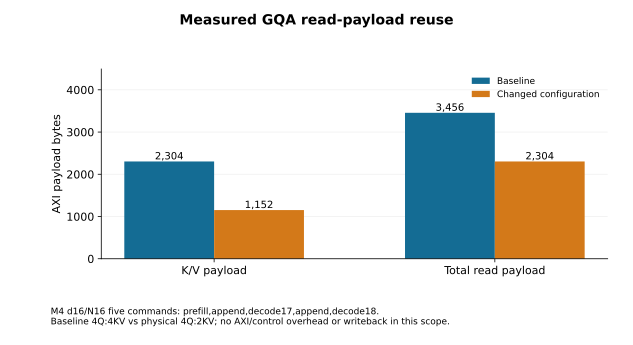

*Matched d16/N16 sequence: PREFILL, APPEND, DECODE L17, APPEND, DECODE L18; 4Q:4KV versus 4Q:2KV.*

[Workload and records](docs/RESULTS.md#physical-gqa-reuse--measured) ·
[Matched measurements](docs/v2/evidence/results/gqa_comparison.json)

</details>

[Results and exact boundaries](docs/RESULTS.md) · [PPA provenance](docs/v2/evidence/results/ppa_provenance.json)

## Verification & Reproduction

Independent bit-exact oracles check every valid external-memory output from the
actual SoC. Recorded tests exercise persistent jobs, partial tiles, poisoned
tails, head/result ownership, AXI backpressure and faults, and reset boundaries.

- **Bounded two-state SoC qualification:** 120 executions / 4,224 successful commands / 3,225,600 exact words, across d16/d64 × 256/16 lanes; modeled latencies 0/20, three timing seeds and final-B hold.
- **Separate safety cases:** 504 fault cases and 264 reset checkpoints check complete-pair publication, head isolation, ownership and common-reset recovery; these are not added to successful-command counts.
- **Historical genuine four-state VCS, V2 d64:** 1,098 commands / 1,317,888 exact words, plus 126 faults and 78 reset checkpoints, in a separate campaign.

**Closure remains partial:** integrated formal, coverage, mapped equivalence and
physical/reset signoff are incomplete. The four-profile Ubuntu matrix is configured,
but **this revised layout has not run in Linux/V2 Actions**.

[Recorded SoC campaign](docs/v2/evidence/verification/verification.json) · [Safety scope](docs/v2/VERIFICATION.md) ·
[Historical VCS provenance](docs/v2/evidence/results/soc_provenance.json) · [Regression receipts](docs/v2/evidence/verification/regression.json)

### Quick start

Use **Verilator 5.046**, a C++ compiler/make and Python 3 with compatible NumPy.
From the repository root:

```sh
v2_run_dir="$(mktemp -d)"

# V2 prefill: four query heads, two physical KV groups.
python3 -B tools/v2/verify.py --dim 16 --lanes 256 --scope prefill \
  --latencies 0 --output-dir "$v2_run_dir/prefill"

# V2 stateful sequence: prefill → append → decode → append → decode.
python3 -B tools/v2/verify.py --dim 16 --lanes 16 --scope focus \
  --latencies 0 --output-dir "$v2_run_dir/sequence"
```

Use `--dim 64` for d64; V2 supports 256 or 16 dequantizer lanes. Every run stages
sources in a temporary path without spaces, freshly lints/builds, checks physical
hierarchy and exact outputs, and rejects wrong-final-word/missing-fixture controls.
Failed verification exits nonzero. The runner installs nothing; reuse no output directory.

`--scope warm` checks changed Q/K/V/scale populations and warm L16 jobs.
`--latencies 0,20,100` selects simulation models, not HBM/DDR measurements.
On macOS, use an existing compatible Python/NumPy launcher; the validated setup
uses Intel Python. [Dependencies, platform notes and full commands](docs/REPRODUCIBILITY.md)

<details>
<summary>Canonical warm-cycle conditions and reproduction boundaries</summary>

For accepted warm-cycle conditions, use `--scope warm --latencies 0 --seeds 0
--final-b-hold 0 --compact 1` with a new output directory. Canonical host
command-to-DONE cycles are d16 **1,228/1,292** and d64 **4,210/4,272** for
256/16 lanes. Nonzero timing seeds or extra final-B hold define different experiments.
[Canonical receipts](docs/v2/evidence/verification/canonical_cycles.json)

The public package supports fresh RTL verification. Historical standalone
benchmarks are not all bundled; independent PPA/power reruns require licensed
tools, the original library and mapped/activity artifacts.

</details>

<details>
<summary>Verification methodology, negative controls and bounded formal scope</summary>

Fresh runs use strict lint, a full production-filelist rebuild, physical lane
hierarchy checks and source/fixture/binary hashes. Preserved V1 smoke and unit
results remain separate. Eight negative controls in the bounded campaign were
rejected: wrong final expected word and missing fixtures, each with its specific
detector, nonzero exit and no simulator PASS.

Cache formal is bounded to 24 steps under legal-host/complete-pair assumptions;
the d16 host adapter passed 12 normalized steps with abstract child/DMA inputs.
Deeper/integrated attempts are INCONCLUSIVE. Code, FSM and functional coverage
are distinct and remain incomplete. No unbounded integrated proof or mapped
equivalence is claimed.

[Verification and gaps](docs/LIMITATIONS.md) · [V1 verification](docs/VERIFICATION.md)

</details>

### Scope and remaining limitations

- **Bounded geometry:** fixed 4Q:2KV, d16/d64, N16 prefill and host decode L16/17/18. No arbitrary shape or model-level floating-point accuracy claim.
- **Verification:** two-state bounded SoC qualification tests supplement historical four-state campaigns; full integrated formal and coverage closure, mapped equivalence and exhaustive fault interleavings remain open.
- **PPA:** d16 mapped standard-cell results only; d64/16 mapping stopped at the 12 GiB resource guard, d64/256 mapping not run. Logical memories, electrical violations and absent physical/reset signoff preclude silicon or achieved-Fmax claims.
- **Reproducibility:** Linux/V2 CI validation of this revised layout remains pending; licensed PPA artifacts and the complete historical archive are not public quick-start dependencies.

[Detailed limits](docs/LIMITATIONS.md) · [Bounded release verdict](docs/RELEASE.md)

## V1 Evolution & Documentation

V1 is the verified single-head N64 foundation: vector DMA, banked staging,
local K/V prefetch, fused output updates and configurable dequantization.
Its matched d16 top uses **66.19% less standard-cell area for 3.28% more cycles**
with 16 dequantizers versus the 256-lane baseline. The recorded RTL sweep passed
**312 invocations / 624 transactions**. These measurements have their own source,
geometry and interface scope, separate from the V2 host SoC.

[V1 design](docs/DESIGN.md) · [V1 verification](docs/VERIFICATION.md) ·
[V1 results and evidence](docs/RESULTS_EVIDENCE.md) ·
[Engineering documentation](docs/README.md)

<details>
<summary>Historical V1 cycle milestones and dequantizer tradeoffs</summary>

Both figures show **single-head N64 V1 measurements**, noncausal, at zero
modeled read latency. Cycles cover `start → done`, excluding host setup,
output readout and AXI output writeback. Each d16/d64 panel uses its own axis scale.

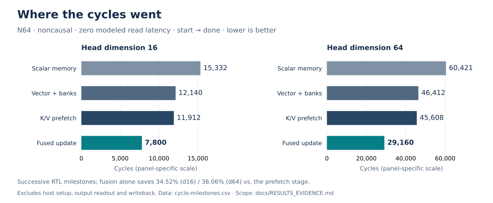

The four successive 256-lane stages show how data movement and fused output
updates reduce cycles. [Cycle data](docs/figures/cycle-milestones.csv) ·
[Historical measurement scope](docs/RESULTS_EVIDENCE.md)

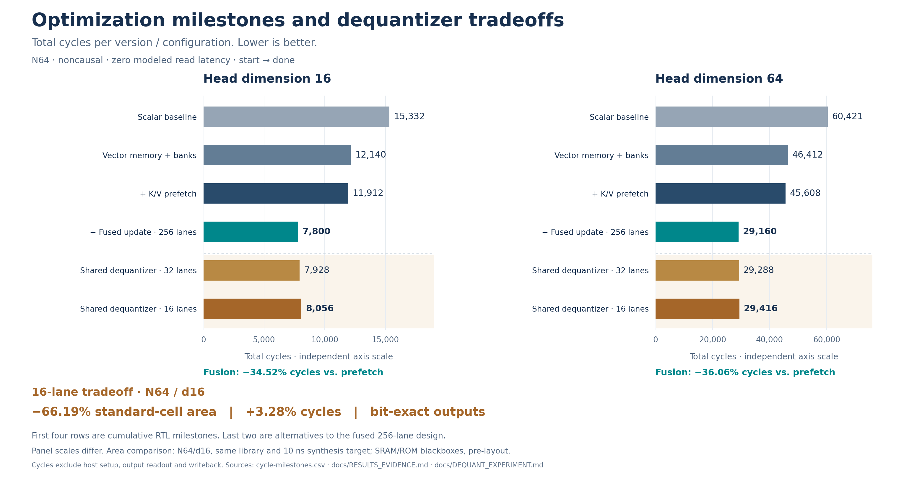

The 32- and 16-lane rows are **alternative configurations of the fused design**.
The area tradeoff is the separate matched **N64/d16** synthesis experiment;
d64 bars show RTL cycles only. [Dequantizer experiment](docs/DEQUANT_EXPERIMENT.md)

</details>

<details>
<summary>V1 architecture and the evolution to V2</summary>

### Original V1 architecture

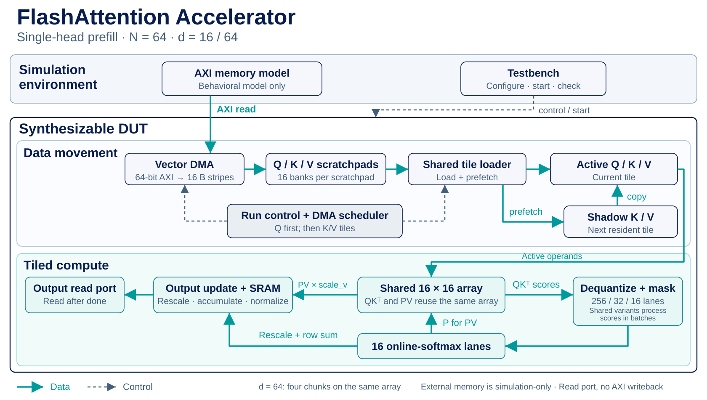

- **Data movement:** 64-bit AXI reads fill 16-bank Q/K/V scratchpads; V1 overlaps local K/V shadow-tile prefetch with compute.
- **Shared compute:** QK uses signed INT8 inputs and INT32 accumulation; PV reuses the same 256 PEs with unsigned 8-bit exponential weights and signed INT8 V. d64 uses four dimension chunks.
- **Online attention:** score tiles update running maxima, sums and rescaled outputs without writing the full attention matrix to external memory.
- **Fused output update:** rescaling and accumulation share one buffer traversal, followed by final normalization.

This diagram describes the single-head V1 path. Its results are read through an
output port after `done`; it has no AXI output writeback. V2 reuses the arithmetic
blocks but uses foreground cache loads with prefetch disabled in its controller.
INT8 inputs, Q8.8 scales and fixed-point rounding/saturation are preserved;
bit-exact reference agreement is not floating-point equivalence.
[V1 design](docs/DESIGN.md) · [V1 results and source identity](docs/RESULTS_EVIDENCE.md)

### From V1 to V2

V2 extends the same arithmetic foundation with persistent state, serial head scheduling and a host-controlled job lifetime.

| Boundary | Verified V1 main path | Current V2 host SoC |
|---|---|---|
| Workload | Single-head N64 prefill, d16/d64; causal/noncausal | N16 prefill and latest-position decode at L16/17/18, d16/d64; causal/noncausal |
| State and heads | One transaction per common reset | Four serial Q heads, two persistent physical KV groups; APPEND, CLEAR and ACK |
| Host/results | Start/done and output read port | AXI4-Lite configuration/status, AXI4 output writeback and IRQ |
| Tile loading | Banked staging with local K/V prefetch overlap | Foreground loads from the selected persistent cache; prefetch disabled in this controller |

The two versions use different workload geometries and interfaces; each reported experiment retains its own matched baseline. [V1 design](docs/DESIGN.md) · [V2 architecture](docs/ARCHITECTURE.md)

</details>

<details>
<summary>V1 exact optimization results and reproduction</summary>

### Original V1 optimization results

| Optimization | Improvement | Test conditions / baseline |
|---|---|---|
| Vector DMA | 312 → 56 cycles (5.57× faster fill) | 256 B, scalar → vector DMA, modeled read latency 10 |
| Banked scratchpad | 256 → 17 cycles (15.06× faster drain) | 256 B, byte-serial → 16-bank stripe read |
| Vector DMA + banked memory | 1.26× / 1.30× E2E speedup | N64 d16/d64, scalar memory → vector/banked memory |
| K/V prefetch | 1.88% / 1.73% fewer cycles | N64 d16/d64, vector/banked top → resident-tile prefetch top |
| Fused output update | 34.52% / 36.06% fewer cycles | N64 d16/d64, unfused → fused prefetch top |
| Shared Q/K scale | 7.35% less core cell area | N64/d16, per-lane → shared scale product, matched synthesis conditions |

Each row has its own baseline; reductions are not additive. E2E rows use noncausal `start → done` at zero modeled read latency. The historical 7.35% result concerns shared scale multiplication, not dequantizer lane reduction. [Historical evidence](docs/RESULTS_EVIDENCE.md) · [V1 coverage/power and limitations](docs/COVERAGE_POWER.md)

### V1 — matched N64/d16 dequantizer sweep

| V1 dequantizer lanes | Standard-cell area, library units | Area reduction | N64/d16 cycles | Setup slack |
|---|---:|---:|---:|---:|
| 256 (default) | 5,074,665.315 | — | 7,800 | +3.92 ns |
| 32 | 1,940,361.688 | 61.76% | 7,928 (+1.64%) | +0.66 ns |
| 16 | 1,715,678.209 | 66.19% | 8,056 (+3.28%) | +2.12 ns |

This is the matched N64/d16 DC sweep at the same 10 ns constraint, with logical SRAM/ROM blackboxes. Cycles are noncausal `start → done`, zero modeled read latency, excluding host setup/readout. Original `d5f9123` maps to equivalent implementation `dd68964`; d64 is functional-only for this synthesis sweep. The recorded RTL sweep passed 312 invocations / 624 transactions. [V1 experiment](docs/DEQUANT_EXPERIMENT.md) · [Original provenance](docs/evidence/2026-10-03/provenance.json)

V1 uses the preserved runners and a checkout path **without spaces**:

```sh
# Single-head N64/d16 core/top smoke, causal and noncausal.
python3 -B sim/verilator/run_dequant_sweep.py --lanes 16 --dim 16 --smoke

# Full default V1 regression.
make -C sim/verilator regression
```

[V1 verification](docs/VERIFICATION.md#reproducing-checks) · [V1 synthesis](syn/README.md)

</details>

### Documentation and repository guide

[Engineering documentation](docs/README.md) · [V2 evidence index](docs/v2/README.md) ·
[Reproduction guide](docs/REPRODUCIBILITY.md) · [Results and boundaries](docs/RESULTS.md)

<details>
<summary>Repository directory guide</summary>

| Directory | Contents |
|---|---|
| `rtl/` | Preserved reusable V1 datapath; [V2 production filelist](rtl/v2/soc/soc.f) selects the complete host SoC |
| `sim/` | V1 regression benches and [actual-SoC safety bench](sim/v2/soc/tb_soc.sv) with its [host scoreboard](sim/v2/soc/tb_soc.cpp) |
| `tools/v2/` | Current fresh-build runner, fixture support and release checks; [tool scope and dependencies](tools/v2/README.md) |
| `golden/`, `data/` | Independent fixed-point references, accepted fixtures and LUT inputs |
| `formal/` | Bounded properties with their original abstraction and assumption limits |
| `syn/` | Preserved synthesis/power flows and logical memory models; licensed inputs required |
| `release/` | Versioned public inventory, original evidence locks and source-path mapping |
| `docs/` | Architecture, results, reproduction and limitations; [V2 evidence index](docs/v2/README.md) |

</details>

Complete development history and large/private raw artifacts remain local. The public package retains the evidence needed to inspect its claims and reproduce the supported RTL checks.

Distribution is for **portfolio review; project reuse licensing remains pending**. No project-level open-source reuse license is granted; existing third-party notices retain their original scope. [Distribution status](DISTRIBUTION.md).
