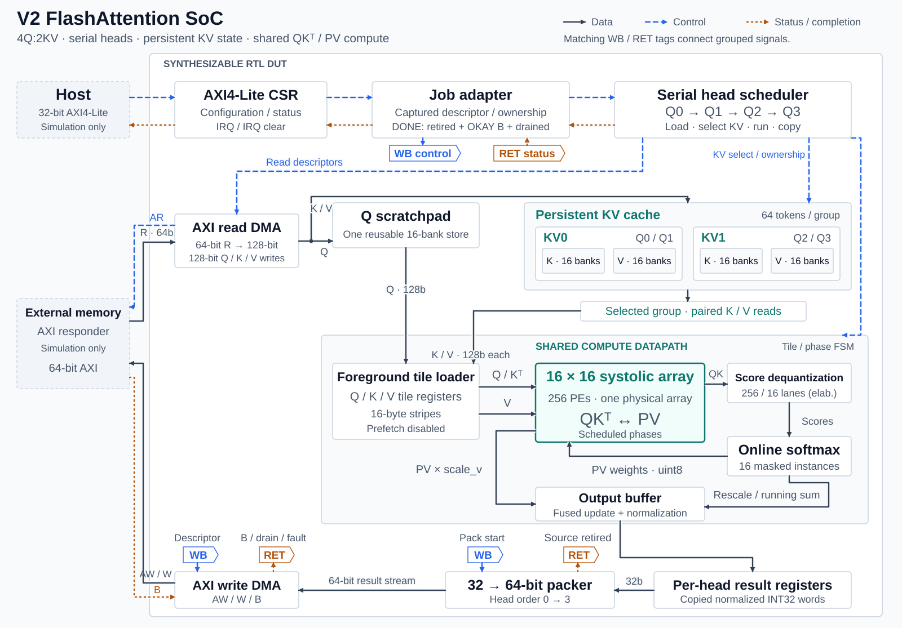
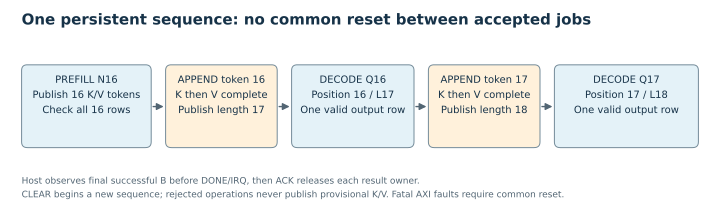
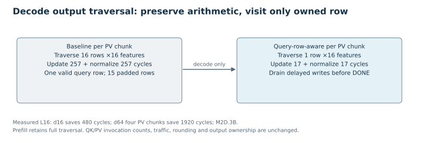
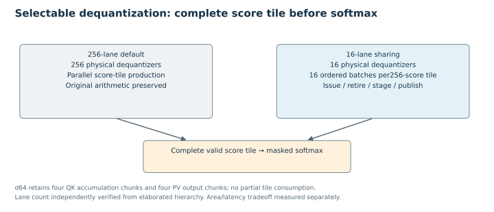

# V2 architecture

[Home](../README.md) · [Results](RESULTS.md) · [Reproduction](REPRODUCIBILITY.md) · [Limits](LIMITATIONS.md)

## Production boundary

[`rtl/v2/soc/soc.f`](../rtl/v2/soc/soc.f) selects the synthesizable production top and 23 RTL files (top included). The AXI4-Lite CSR maintains configuration and exposes control/status and IRQ; the job adapter captures accepted active descriptors and owns compute/output/writeback lifetime. The serial engine schedules four Q heads over two physical K/V groups: Q0/Q1→KV0, Q2/Q3→KV1. There is one shared 16×16 array,256 PEs,81 logical SRAM instances and 16 exponential ROMs. The C++ host and coherent byte-addressed AXI responder are simulation-only.

Banked scratchpads stage DMA data. The V2 controller uses foreground tile loads. Reused loader/core sources retain active/shadow registers and prefetch machinery, but this controller explicitly disables prefetch; no V2 overlap benefit is claimed. The read DMA writes accepted K/V stripes directly into the selected physical persistent cache during PREFILL/APPEND; Q is loaded into the shared compute scratchpad. Cache decode reads use the real banked loader path; no testbench substitutes cache contents. K then V DMA writes remain provisional until complete-pair commit publishes the new valid length. Physical SRAM data has no reset; validity/ownership gates exclude stale contents.

The shared array performs signed INT8 QK accumulation, then unsigned8-bit exponential weights × signedINT8 V. d64 uses four 16-feature QK accumulation chunks and four PV output chunks. Dequantization uses signed Q8.8 scales, full scale product, rounding, INT16 saturation and dimension shift. Masked online softmax excludes invalid score columns from maxima, sums and exponentials. Fused output updates preserve V1 truncation/wrap; final signed division truncates toward zero.

## Persistent sequence and host contract

HEAD_DIM16 or64; fixed host4Q:2KV. N16 PREFILL establishes a new bounded sequence and 16 tokens. APPEND adds one token per physical KV group, capacity 64. Host DECODE supports L16/17/18, one query per head, absolute query positionL−1; unsupported descriptors reject. Earlier single-head variable-length verification does not extend this host interface. CLEAR invalidates ownership/length and starts a new sequence; SRAM bits need not be zeroed. Rejected/full-cache operations cannot publish new metadata. Fatal AXI faults require common reset and do not roll back external writes.

Successful compute output remains owned through packing and writeback. The adapter waits for source retirement and final OKAY B without outstanding writes before host DONE/IRQ; ACK releases the job. Busy starts cannot replace captured configuration. Error/reject/IRQ status and CLEAR/ACK are explicit host operations. CSR fields and original milestone contracts remain in the complete local history; the release includes the actual CSR implementation and verification bench.

## Isolated performance choices

Decode traversal uses the captured one-query/prefill contract, not mode alone. Only owned row features are visited per PV chunk; delayed writes still drain before completion. Prefill retains full traversal and arithmetic. Matched L16 cycle savings are480d16 and 1920d64; array/DMA/cache work is unchanged.

`DEQUANT_LANES=256` remains default. The 16-lane path batches a256-score tile through 16 physical dequantizers with ordered issue/retire counters and score staging. Softmax cannot consume an incomplete tile. Both traversal variants remain selectable. Reusable V1 PEs, dequantizers, memories and arithmetic retain their exact source identities.

## Source entry points

| Function | Source |
|---|---|
| Host integration |[SoC](../rtl/v2/soc/flash_attn_soc.sv),[CSR](../rtl/v2/soc/axi_lite_csr.sv),[job adapter](../rtl/v2/soc/soc_job_adapter.sv) |
| Head/cache scheduling |[serial engine](../rtl/v2/soc/flash_attn_serial.sv),[persistent cache](../rtl/v2/cache/kv_cache_banked_decode.sv) |
| Compute/staging/masks |[core](../rtl/v2/compute/flash_attn_core_decode.sv),[masked softmax](../rtl/v2/compute/online_softmax_masked.sv),[shared dequantizer](../rtl/quantization/dequantizer_tile.sv) |
| External results |[packer](../rtl/v2/soc/gqa_output_packer.sv),[write DMA](../rtl/v2/interface/dma_write_engine.sv) |
| Independent oracle |[logical-row reference](../golden/v2/stateful/decode_reference.py),[fixtures](../tools/v2/soc/fixtures.py) |

The two matched d16 PPA endpoints use the same frozen d16 PPA baseline source snapshot. The current SoC d16/d64 host top is a distinct implementation identity; the earlier pair does not establish mapped equivalence or d64 PPA for that top. See [results](RESULTS.md).
